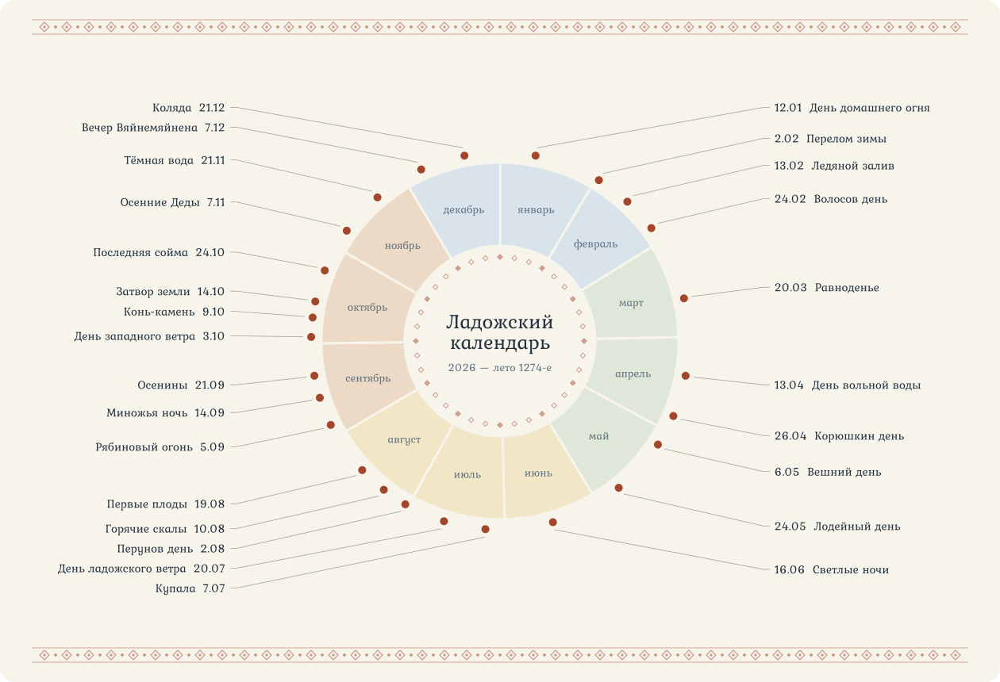
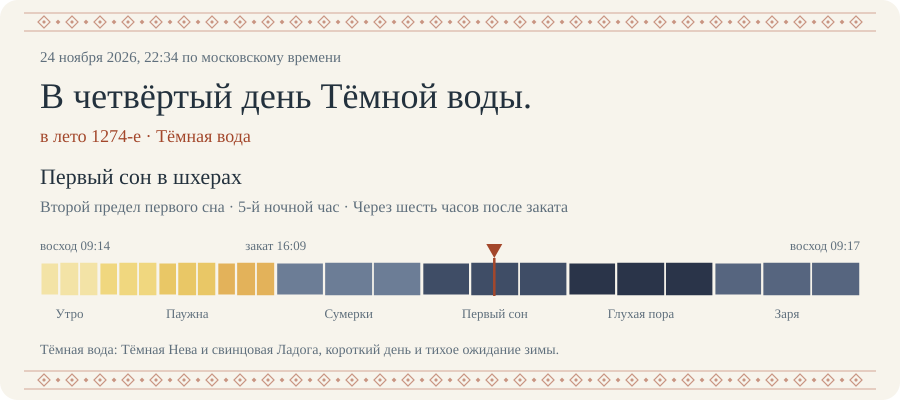
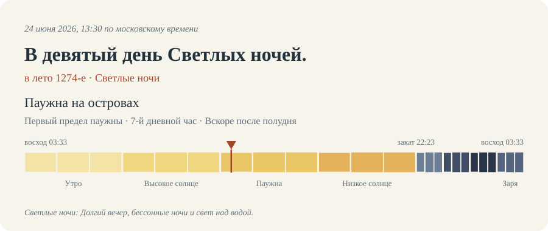

# Ладожский календарь

**Ladoga Calendar** is a modern authorial calendar for Lake Ladoga, the Neva river and the eastern Gulf of Finland (Russia). It expresses an ordinary Gregorian date through the nearest of 26 fixed annual holidays and its own year count, the "Years of Ladoga" (`era_year = gregorian_year - 752`). The repository ships ready-made JSON files, one per year from 2025 to 2038, built from a single definitions file (`data/index.json` is the entry point): every day already has a finished Russian phrase, so a consumer needs no date arithmetic and no Russian grammar for the date. A time-of-day layer ("Ladoga time") splits daylight and night into 12 seasonal hours each and eight named periods, computed for the source of the Neva; per-day sunrise, noon, sunset and period changes are precomputed too. The calendar and its holidays are an authorial project, not a reconstruction of a historical system. Everything in this repository is dedicated to the public domain under [CC0 1.0](LICENSE), except the vendored `vendor/astronomy-engine/` (MIT, see its LICENSE) and `tz/Europe/Moscow` (from the public-domain IANA tz database). The rest of this README is in Russian.

---

## Что это

«Ладожский календарь» — современный авторский календарь для Ладожского озера, Невы и восточной части Финского залива. Счёт лет идёт от Старой Ладоги на Волхове. Обычная дата в нём записывается через ближайший праздник и собственный счёт лет:

> В третий день Тёмной воды, в лето 1274-е.

Это 23 ноября 2026 года.

В календаре соединены славянские народные мотивы, карело-финская эпическая традиция и местная жизнь: Ладога, Нева, залив, скалы, лодки, ветер, белые ночи, лес, корюшка и долгие зимние вечера. Многие праздники придуманы для этого календаря, и это сознательная часть замысла. Применение календаря к прошлым годам — условная датировка по его правилам, а не утверждение, что такая система тогда существовала.



Два дня календаря. На полосе внизу — сутки от восхода до восхода: 12 дневных и 12 ночных сезонных часов, по три на пору. Зимой дневные часы короткие, а ночные длинные, летом наоборот. Треугольник — показанный момент.





## Что лежит в репозитории

| Путь | Что это |
| --- | --- |
| `data/ru/2025.json` … `data/ru/2038.json` | Готовые данные: по одному файлу на год, в каждом подпись для каждого дня |
| `data/index.json` | Оглавление: диапазон лет, языки и пути к файлам |
| `data/ru/holidays.json` | Названия и описания праздников для показа |
| `data/time/2025.json` … `data/time/2038.json` | Время суток: восход, полдень, закат и смены пор на каждый день |
| `data/ru/time.json` | Названия пор и шаблоны подписей времени |
| `data/sun/2025.json` … `data/sun/2038.json` | Точные моменты восхода, полудня и заката в UTC |
| `ladoga-definitions.json` | Правила календаря: праздники, счёт лет, шаблоны фраз, источники. Из него собираются файлы в `data/` |
| `scripts/build_calendar.py` | Генератор, который собирает `data/` из правил |
| `scripts/build_sun.py` | Расчёт восходов и закатов для `data/sun/` |
| `scripts/ladoga_time.py` | Показ времени суток для любого момента |
| `scripts/check_calendar.py` | Скрипт, который независимо проверяет правила и данные |
| `scripts/build_images.py` | Рисует картинки для этого описания (`docs/img/`) по файлам `data/` |
| `docs/ladoga-calendar.md` | Подробное устройство календаря и формата данных |
| `docs/ladoga-time.md` | Время суток («Ладожское время»): сезонные часы и восемь пор |
| `vendor/astronomy-engine/` | Библиотека Astronomy Engine 2.1.19 (лицензия MIT) для `build_sun.py` |
| `tz/Europe/Moscow` | Файл часового пояса из tzdb 2026e |
| `AGENTS.md` | Правила работы над проектом |
| `LICENSE` | Текст лицензии CC0 1.0 |

Все файлы — в кодировке UTF-8. Файл одного года весит около 134 КБ.

## Как пользоваться

Откройте файл нужного года и возьмите запись по дате в формате `YYYY-MM-DD`. Дата — московская: календарный день начинается в полночь по часовому поясу `Europe/Moscow`.

Из командной строки с помощью `jq`:

```bash
jq -r '.dates["2026-11-23"].text' data/ru/2026.json
# В третий день Тёмной воды.
jq -r '.dates["2026-11-23"].full_text' data/ru/2026.json
# В третий день Тёмной воды, в лето 1274-е.

# Today in Moscow, whatever the local time zone is:
d=$(TZ=Europe/Moscow date +%F); jq -r --arg d "$d" '.dates[$d].text' "data/ru/${d%%-*}.json"
```

На Python, для сегодняшней даты:

```python
import json
from datetime import datetime
from pathlib import Path
from zoneinfo import ZoneInfo

data = Path("data")
index = json.loads((data / "index.json").read_text(encoding="utf-8"))

# The calendar day is the local date in Europe/Moscow.
today = datetime.now(ZoneInfo(index["timezone"])).date()

path = index["files"]["ru"].get(str(today.year))
if path is None:
    print("Date is outside the calendar range")
else:
    year = json.loads((data / path).read_text(encoding="utf-8"))
    entry = year["dates"][today.isoformat()]
    print(entry["text"])       # day phrase, e.g. "В третий день Тёмной воды."
    print(entry["full_text"])  # the same with the year
    print(entry["short"])      # short form, e.g. "3-й д. Тёмной воды · лето 1274"
```

Внутри `dates` каждая запись дня занимает ровно одну строку вида `    "2026-11-23": {...}`. Это обещание формата, и скрипт проверки за ним следит. Поэтому программа без разбора JSON может найти запись по дате. Искать нужно ключ вместе с `: {`, потому что та же дата встречается и внутри других записей:

```bash
grep -F '"2026-11-23": {' data/ru/2026.json
```

Запись одного дня выглядит так (`2026-12-10`):

```json
{
  "era_year": 1274,
  "anchor_id": "vainamoinen",
  "anchor_date": "2026-12-07",
  "anchor_year": 2026,
  "offset_days": 3,
  "day_text": "Через три дня после Вечера Вяйнемяйнена",
  "text": "Через три дня после Вечера Вяйнемяйнена.",
  "full_text": "Через три дня после Вечера Вяйнемяйнена, в лето 1274-е.",
  "short": "Через 3 дн. после Вечера Вяйнемяйнена · лето 1274"
}
```

- `text` — готовая подпись дня без года, с точкой: её удобно показывать каждый день;
- `full_text` — та же подпись вместе с годом;
- `day_text` — часть про день без точки, чтобы вставлять в свою фразу;
- `short` — краткая запись: расстояние до праздника цифрами и год в конце («За 4 дн. до Миножьей ночи · лето 1274», «3-й д. Тёмной воды · лето 1274»);
- `offset_days` — сколько дней прошло после праздника (положительное число) или осталось до него (отрицательное); `0` — сам праздник;
- `anchor_id` и `anchor_date` — какой праздник выбран опорным и когда он был.

Кроме `dates`, в файле года есть, среди прочего (полный список — в `docs/ladoga-calendar.md`):

- `era_year` — номер ладожского лета;
- `year_phrase` — «в лето 1274-е»;
- `holiday_dates` — даты всех праздников этого года.

Названия и описания праздников (полное название, смысл, предложенные обычаи, исторические оговорки) лежат в `data/ru/holidays.json`. Найти праздник можно по `anchor_id` из записи дня. Список праздников с датами в виде «день.месяц»:

```bash
jq -r '.holidays[] | "\(.day).\(.month) \(.name)"' data/ru/holidays.json
# 12.1 День домашнего огня
# 2.2 Перелом зимы
# ...
```

Если года нет в `data/index.json`, дата вне диапазона. Если год есть, а даты нет в `dates`, такой даты не существует, например 29 февраля 2026 года. В обоих случаях нельзя подставлять ближайшую дату или другой год. Опорный праздник может быть за пределами диапазона: для 1 января 2025 года это Коляда 21 декабря 2024 года, а файла 2024 года нет.

## Время суток

Кроме даты, можно показать пору дня или ночи по Солнцу. От восхода до заката идут 12 дневных часов, от заката до восхода — 12 ночных. Каждые три часа — одна пора: Утро на Неве, Высокое солнце над Ладогой, Паужна на островах, Низкое солнце над заливом, Сумерки у рыбацких костров, Первый сон в шхерах, Глухая пора на Вуоксе, Заря за Свирью. Каждый из трёх часов поры — её предел: «Сутки на восемь пор, пора на три предела». Так 5-й ночной час — второй предел первого сна. Предел — отрезок поры, а не граница; слово в этом смысле и присловье придуманы для календаря, а навеяны песнями и сказками Тикки Шельен. Расчёт ведётся для истока Невы. Сезонные часы и пределы — двенадцатые доли дня или ночи, а в подписях вида «Через шесть часов после заката» часы обычные, по 60 минут.

```bash
python3 scripts/ladoga_time.py 2026-11-24T12:00:00+03:00 --style full
# В четвёртый день Тёмной воды, в лето 1274-е, при высоком солнце.
python3 scripts/ladoga_time.py now                     # current pora
python3 scripts/ladoga_time.py 2026-11-24T12:00:00+03:00 --style part
# Второй предел высокого солнца
python3 scripts/ladoga_time.py 2026-11-24T12:00:00+03:00 --style relative
# Незадолго до полудня
```

Без Python пору можно найти в `data/time/<год>.json`: у каждого дня есть список смен пор по местному времени, и нужна последняя запись, время которой не позже текущего:

```bash
read -r d t < <(TZ=Europe/Moscow date '+%F %T')
id=$(jq -er --arg d "$d" --arg t "$t" '[.dates[$d].poras[] | select(.[0] <= $t)] | last | .[1]' \
  "data/time/${d%%-*}.json" 2>/dev/null) || { echo "no record for $d" >&2; exit 1; }
jq -r --arg id "$id" '.poras[] | select(.id == $id) | .name' data/ru/time.json
```

Сезонный час («5-й дневной час»), предел поры («Второй предел высокого солнца») и подпись «Незадолго до полудня» требуют расчёта; их даёт `scripts/ladoga_time.py`.

Подробности — в `docs/ladoga-time.md`.

## Правила календаря

**Счёт лет.** Эра называется «Лета Ладоги». Номер лета равен григорианскому году минус 752. Например, 2026 год — 1274-е лето. Эпоха условна: 753 год взят по археологической дендродате и не означает точный год основания поселения. Номер лета меняется 1 января.

**Праздники.** Все 26 праздников каждый год приходятся на одни и те же григорианские даты.

**Опорный праздник.** Для каждой даты выбирается ближайший праздник, в прошлом или в будущем. Если до двух праздников одинаково далеко, выбирается прошедший. Подпись строится так:

- в сам праздник — его собственная фраза, например «В Корюшкин день»;
- накануне — «В канун Купалы»;
- на следующий день — «На другой день после Купалы»;
- за несколько дней — «За пять дней до Коляды»;
- через несколько дней — «В третий день Купалы» или «Через три дня после Перунова дня».

Дни праздников, что длятся (Купала, Коляда, Тёмная вода), считаются по-народному: сам праздник — первый день. Поэтому «в третий день Купалы» — через два дня после Купалы, 9 июля. После праздников-мгновений (Равноденье, Конь-камень) и праздников со словом «день», «ночь» или «вечер» в названии счёт обычный: «Через два дня после Перунова дня».

Наибольшее расстояние до опорного праздника — 12 дней: «За двенадцать дней до …» или «В тринадцатый день …».

**Часовой пояс** — `Europe/Moscow`. Сутки начинаются в местную полночь.

## Праздники

| Дата | Праздник |
| --- | --- |
| 12 января | День домашнего огня |
| 2 февраля | Перелом зимы |
| 13 февраля | Ледяной залив |
| 24 февраля | Волосов день |
| 20 марта | Равноденье |
| 13 апреля | День вольной воды |
| 26 апреля | Корюшкин день |
| 6 мая | Вешний день |
| 24 мая | Лодейный день |
| 16 июня | Светлые ночи |
| 7 июля | Купала |
| 20 июля | День ладожского ветра |
| 2 августа | Перунов день |
| 10 августа | Горячие скалы |
| 19 августа | Первые плоды |
| 5 сентября | Рябиновый огонь |
| 14 сентября | Миножья ночь |
| 21 сентября | Осенины |
| 3 октября | День западного ветра |
| 9 октября | Конь-камень |
| 14 октября | Затвор земли |
| 24 октября | Последняя сойма |
| 7 ноября | Осенние Деды |
| 21 ноября | Тёмная вода |
| 7 декабря | Вечер Вяйнемяйнена |
| 21 декабря | Коляда |

Даты Равноденья, Осенин и Коляды — символические. Настоящие астрономические моменты не вычисляются.

Кроме праздников, в данных описаны события, которые записываются по наблюдению: Вскрытие Невы, Ладожский лёд (второй весенний ледоход по Неве), Первая корюшка, Первая минога, Первый иней, Наводнение и Ледостав. У них нет постоянных дат. Пока не записано ни одного наблюдения, и на готовые подписи эти события не влияют.

## Старые и местные слова

| Слово | Значение |
| --- | --- |
| лето | год: «в лето 1274-е» — в 1274-м году |
| канун | день перед праздником |
| паужна | по-северному летняя рабочая еда между обедом и вечерей |
| шхеры | скалистые острова и проливы между ними у северного берега Ладоги |
| луда | голый каменный островок |
| угор | высокий берег |
| предел | один из трёх часов поры, её треть: «второй предел первого сна». Это сезонный час, поэтому зимней ночью он длится около полутора обычных часов, летней — около получаса |
| сойма | ладожское парусное судно |
| бурак | плетёная ловушка для миноги |
| кокко | большой иванов костёр у карелов и финнов |
| Укко | карельский и финский громовник |
| руны | старые карельские и финские песни |
| кантеле | карельский и финский струнный инструмент |
| Коневец | остров у западного берега Ладоги |
| Вуокса | река, что течёт к Ладоге через Карельский перешеек |
| Свирь | река, что несёт в Ладогу воду Онежского озера |

## Источники

Исторические и природные сведения подтверждены источниками из раздела `sources` в `ladoga-definitions.json`. У каждого праздника в поле `historical_note` прямо сказано, что в нём взято из традиции, а что придумано для календаря. Например, источник о весеннем ходе корюшки в Неву подтверждает сам промысел, но не существование исторического Корюшкиного дня 26 апреля.

## Проверка и сборка данных

Нужен только Python 3.11 или новее, сторонние библиотеки не требуются: астрономическая библиотека для `build_sun.py` уже лежит в `vendor/`.

```bash
python3 scripts/build_sun.py                # recompute data/sun/ (only when the time model or its pins change)
python3 scripts/build_sun.py --check        # make sure data/sun/ is up to date, write nothing
python3 scripts/build_calendar.py           # rebuild the rest of data/ from ladoga-definitions.json
python3 scripts/build_calendar.py --check   # make sure data/ is up to date, write nothing
python3 scripts/check_calendar.py           # independent check of rules and data
python3 scripts/build_images.py             # redraw docs/img/ after data changes (--check compares)
```

Праздники и правила меняют только в `ladoga-definitions.json`, а потом пересобирают `data/`. У скрипта проверки есть своя таблица праздников и свои правила построения фраз. По ним он заново рассчитывает каждую запись, независимо от генератора, и сравнивает с данными. Поэтому при намеренном изменении праздника его нужно поправить и в этой таблице, подробности — в `docs/ladoga-calendar.md`. Если всё совпадает, обе проверки заканчивают вывод строкой с `OK`, иначе печатают `FAILED` и список ошибок.

Данные устроены так с версии формата 2.0.0. Раньше был один файл `ladoga-calendar-2025-2038.json`; как перейти со старого формата, описано в `docs/ladoga-calendar.md`.

## Лицензия

Всё содержимое репозитория — данные, тексты и код, кроме папок `vendor/` и `tz/`, — передано в общественное достояние по [CC0 1.0 Universal](LICENSE). Его можно свободно копировать, изменять и использовать для любых целей, в том числе коммерческих, без разрешения и без указания автора.

Это не касается внешних материалов, на которые ссылается раздел `sources`: права на них принадлежат их авторам. Библиотека `vendor/astronomy-engine/` распространяется по своей лицензии MIT (файл `vendor/astronomy-engine/LICENSE`), а файл `tz/Europe/Moscow` взят из базы часовых поясов IANA (tzdb), которая находится в общественном достоянии.
